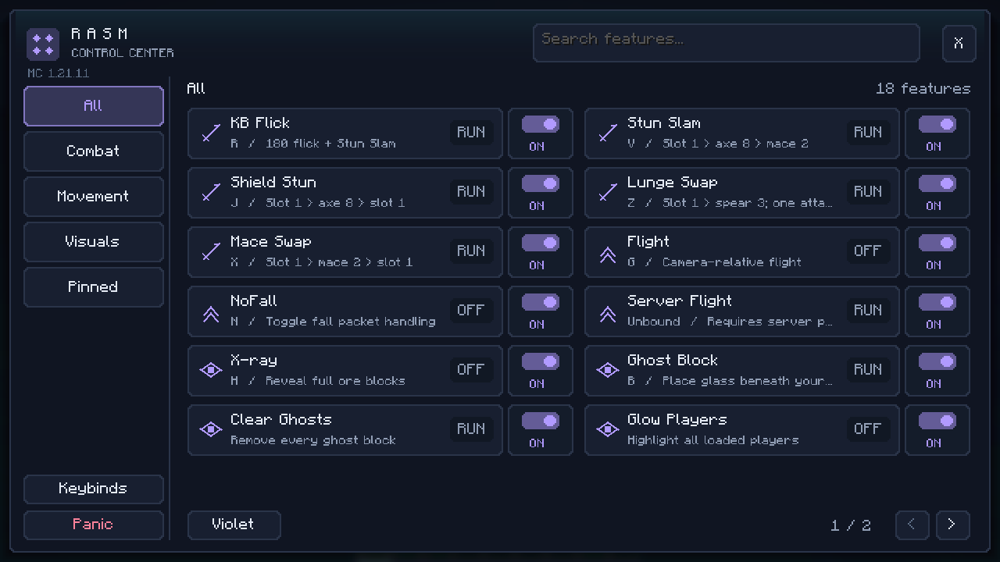
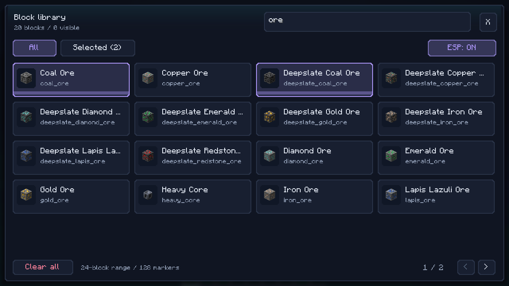

# Rasm Client

[Download Rasm Client 0.1.0](https://github.com/addalarutvik-rgb/minecraftrasm/raw/refs/heads/main/downloads/rasm-client-0.1.0.jar)

Install with Fabric Loader and Fabric API for Minecraft **1.21.11**. Save the JAR
in your Minecraft instance's `mods` folder without extracting it.

A Fabric mod for **Minecraft Java 1.21.11** using Java 21, with client-side
flight and an optional server-permitted flight mode. Client-side flight only
requires Fabric Loader, Fabric API, and Rasm on your own client.

## Desktop installer

[Download the standalone installer](https://github.com/addalarutvik-rgb/minecraftrasm/raw/refs/heads/main/downloads/rasm-installer.jar).
Double-click it with Java 21 installed, or run `java -jar rasm-installer.jar`.
Close Minecraft, choose your instance folder (the folder containing `mods`), and
click **Install / update Rasm**. Start your Fabric 1.21.11 installation and press
`[` to open the dashboard. Fabric Loader and Fabric API must already be installed.
For launchers with separate instances, use **Browse** to select the right instance.

The installer includes the client; no separate mod download or manual file copy
is needed. It backs up previous Rasm JARs to `rasm-backups` outside `mods`, preserves
other mods, and refuses to overwrite an unrelated file using the same filename.
Do not put the installer JAR itself in `mods`.

This is an installer, **not a live injector**. The client still loads from the
instance's mods folder on startup. An already-running Minecraft session must be
restarted because the features rely on Fabric startup hooks and mixins.
Double-clicking requires an executable JAR association; if your OS opens an archive
viewer instead, use the Java command above. Desktop behavior was checked on Linux;
Windows and macOS have not been tested here.

## Dashboard





The `[` control center has All, Combat, Movement, Visuals, and Pinned sections.
Search spans every category. Feature rows show their action/state, current key,
and a separate **ON/OFF master switch** on the right. Click the main row to run
or toggle a feature; the master switch controls whether it can run at all.
Right-click a row to pin/unpin it, then use **Pinned** for a compact favorites list.
Disabled features can still be pinned, but left-clicking them does not run them.

Use **Mint / Violet / Amber** at the bottom to cycle accent colors. Navigation,
search, switches, and the block picker share the same theme. Favorites and theme
choices last for the current session. The selected category is remembered when
reopening the dashboard. **Keybinds** opens Minecraft's binding editor; **Panic**
stays available in the sidebar. Close with X or Escape. Smaller GUI sizes use
pagination; wider layouts can show two columns of feature rows.

The Block ESP library now shows item icons and a clear selection border. **All**
and **Selected** filters share the name/ID search. ESP ON/OFF pauses highlights
without clearing selections; **Clear all** removes them. Blocks without item
forms still appear in the registry browser with a placeholder icon.

## Master switches, Auto Stun Slam, and Block ESP

Every feature card now has a separate **ON/OFF master switch** on the right
side. OFF stops that feature and blocks its hotkey and card action. ON permits
use; it does not automatically run an attack or turn on flight. The main row
still runs the action or toggles its active state. Menu access, keybind editing,
and Panic always remain available. Switches last for the current client session.
Panic sets **all master switches OFF**, so hotkeys cannot restart a feature until
you explicitly enable its switch again.

**Auto Stun Slam** is a separate Combat card, initially inactive. Enable it and
leave the Stun Slam master switch ON. It activates once per fall when you are
descending, have fallen at least half a block, and aim directly at a live player
within normal melee reach and line of sight. It requires an axe in slot 8 and a
mace in slot 2. It does not trigger on mobs, while in a GUI, while flying/gliding,
or during another swap/flick. Landing rearms it. The same manual Stun Slam timing
is used; each attack rechecks the target. Disabling Stun Slam also stops automation.
Auto mode resets on disconnect and Panic. Multiplayer shield/smash results still
depend on server combat rules and have not been verified with this automation.

**Block ESP** opens a searchable, paginated list of every registered block under
Visuals. Search by localized name or full registry ID. Click entries to select
multiple types; click again to remove them. Selected loaded blocks get teal
wireframe boxes through terrain. The picker includes ESP ON/OFF and Clear selections.
The incremental scan covers a **24-block radius**, updates over roughly 1.5 seconds,
and caps the display at **128 markers**. It cannot reveal data the server has not
sent. Selections reset on disconnect/Panic. Outlines use the standard camera FOV;
shader/third-party camera compatibility is unverified.

## Panic

Press **End** (rebindable) or the red **PANIC** button at the bottom of the dashboard.
It silently disables client flight, NoFall, X-ray, and custom glow; clears ghost
blocks; cancels combat sequences; restores an active swap's return slot and a
pending flick's original yaw; and discards queued feature hotkeys. The dashboard
closes. All feature master switches remain off until you enable them again. The key also works in
chat/inventory screens, except the keybind editor so you can rebind it normally.
This disables Rasm features, not Minecraft's vanilla glow or creative abilities.
Server-permitted Rasm flight receives an explicit disable-only request when the
server supports it; multiplayer servers need this updated Rasm version for that
request. Existing server-granted permissions are preserved.

## Lunar on Windows

This is a Fabric 1.21.11 mod, not a Lunar injector. Lunar compatibility has not been
verified here (its support site was inaccessible from the build environment).
If your Lunar profile supports custom Fabric mods for 1.21.11, use its supported
mods-folder control and select that instance in the installer. Do not assume the
standard `%APPDATA%/.minecraft` folder is Lunar's active instance. If the profile
does not support custom Fabric mods, use a separate Fabric 1.21.11 installation.
The installer cannot add Fabric support to a running Lunar session.

## Controls

| Default key | Action |
| --- | --- |
| `[` | Open the Rasm Client menu |
| End | Panic: disable all Rasm features |
| R | KB flick + immediate Stun Slam |
| G | Toggle client-side flight |
| N | Toggle Nofall |
| Z | One lunge swap (slots 1 / 3) |
| X | One mace swap (slots 1 / 2) |
| B | Add a ghost block under your feet |
| V | Stun Slam: slot 1 → axe 8 → mace 2 |
| H | Toggle ore X-ray |
| J | Shield Stun: slot 1 → axe 8 → slot 1 |

Change every action binding in **Options → Controls → Key Binds → Rasm Client**,
or click **Rebind keys** in the Rasm menu. Server-permitted flight is unbound by
default and can also be assigned a key. Minecraft saves these bindings.
If upgrading from an older build, Minecraft may retain the previous menu key;
set **Open Rasm menu** to **[** there (or reset that binding to its new default).
The KB flick rotates out by +180 degrees, synchronizes the current sprint state,
sends the new facing, and sends an **entity attack in the same client tick**. It
immediately starts Stun Slam against that same locked target: slot 1 → axe in
slot 8 after one tick, then a mace in slot 2 one tick after the axe hit.
The camera returns by -180 degrees after the axe hit (about 50 ms); the mace
follows with the slightly slower Stun Slam timing. One R press or
**KB flick + Stun Slam** menu click runs the combination; you no longer need to
press both buttons. Put an axe in slot 8 and a mace in slot 2. Without those items,
the ordinary flick still runs and the swap is silently skipped.
Active swap sequences block a new flick. No block-click/mining action is sent.
This automates the user's reported working combination; multiplayer displacement
with the combined button has not been verified here.

It first locks the living entity under your crosshair **before** turning, then
attacks that same target with the reversed facing. Aim at your opponent and press R.
If there is no aimed target, it falls back to an in-reach player in the rear cone
or a living entity under the backward crosshair. Reach and line of sight are checked at the hit.
If no target qualifies, it still turns, swings, and runs the slot sequence. Pitch is preserved.

For bonus knockback, sprint before triggering R with a charged attack, or use a
Knockback-enchanted weapon. The action preserves your sprint state; it does not
force sprint or grant enchantments. Minecraft 1.21.11 uses the attack yaw for extra
sprint/enchantment knockback, while base knockback also depends on positions.
Consequently, sideways displacement depends on your angle, weapon, cooldown,
resistance, and server mechanics; a 180-degree turn alone cannot guarantee it.
The [reference video](https://www.youtube.com/watch?v=7t0PyqYsac8) was blocked here.

## Swap actions

**Z — Lunge swap once:** slot 1 holds your low-cooldown item (or empty hand),
slot 3 holds a Lunge-enchanted spear. Each press selects slot 1, allows one preparation
tick, switches to slot 3 and clicks once, then returns to slot 1 on the next tick.
There is no initial slot-1 attack. Press again to repeat; presses
during an unfinished sequence are ignored. There is no automatic loop. Hunger,
enchantments, and server mechanics still apply.

**X — Mace swap once:** slot 1 holds your initial weapon and **slot 2** holds the
mace. It attacks with slot 1, changes to slot 2 for a second attack, and returns
to slot 1. It does not create fall distance or guarantee extra damage.

Opening a menu, disconnecting, dying, or changing worlds cancels a pending swap.

## X-ray

Press **H** or click **X-ray** in the menu to hide ordinary block models and show
ore blocks and ancient debris at full brightness. All six ore faces are enabled,
including faces touching hidden terrain or adjacent ores. X-ray also disables
block-state face occlusion, preserving the complete cube geometry. Toggle it off to rebuild normal
terrain. H can be rebound, and disconnecting resets the feature. Fluids, entities,
and special block-entity models are not hidden. Collision and mining reach are
unchanged. Only blocks actually sent to your client can be revealed; server
anti-X-ray can conceal ores or send fake ore data. Third-party rendering mods
have not been tested.

## Shield Stun

Press **J** or click **Shield Stun 1 / 8 / 1** in the `[` menu while aiming at an
opponent within melee reach. Put an axe in slot 8. One press selects slot 1,
waits one tick (~50 ms), switches to slot 8 and attacks, then returns to slot 1
on the next tick (~100 ms total). No axe-charge wait or mace is required. The key can be rebound.
Missing axes leave your slot unchanged; active
Lunge/Mace/Stun Slam sequences prevent this action from interfering with them.
The attack never mines blocks. The server still decides whether the hit disables
a shield, based on its combat rules and attack state. Live shield-disable behavior
has not been verified for this new action.

## Stun Slam

Put an **axe in hotbar slot 8** and a **mace in slot 2**. Aim at a living entity
within melee reach, then press **V** or click **Stun Slam 1 / 8 / 2** in the menu.
The action selects slot 1, waits one tick (~50 ms), switches to the axe in slot 8
and attacks, then waits one tick (~50 ms) before switching to the mace in slot 2
and attacking. It restores your original slot one tick later (~150 ms total). There is no axe-charge
wait. Slot 1 is selected without sending an attack, preserving existing attack
charge as far as the server permits. Each press runs one sequence.

Both attacks use the aimed living entity when it remains alive, visible, and in reach.
Without a valid target, the sequence continues with air swings. This never sends a block-mining click. Put a low-cooldown item
in slot 1. Fast switching does not guarantee bypassing server cooldowns, shield
disabling, or smash damage; falling distance and server combat rules still apply.
The revised fast sequence and front-target KB displacement need live PvP testing.

## Entity glow

Use `/glow Rasmore` to highlight one online player by username (case-insensitive).
Player names autocomplete from the current server's player list. Repeat with other
names to select multiple players; existing mob filters remain active. Selections
track player UUIDs and apply when those players are loaded, including after they
come into render distance. `/glow only Rasmore` replaces all filters with that
player. For names that collide with a filter or command, use `/glow player NAME`
(or `/glow only player NAME`). Offline/unknown names report an error without
clearing existing selections.

Filters stack: `/glow slime` followed by `/glow creeper` highlights both types.
`/glow @a` or `/glow players` adds all loaded players. `/glow hostile` adds mobs
in Minecraft's MONSTER category; `/glow passive` adds other mobs (including neutral
animals; this is a type category, not their current aggression state).

For an exclusive selection, use `/glow only hostile`, `/glow only passive`, or
`/glow only players`. `/glow only creeper` also works. `/glow clear` and `/glow off`
remove all custom filters. Vanilla glow is preserved. Filters reset on disconnect.
These commands run locally and only affect entities loaded by the client.

## Ghost blocks

Every press of **B** or **Place ghost** adds another full client-only glass block
under your feet, provided that cell is air. Move or jump to place more blocks;
existing ghost blocks stay in place. The menu displays the tracked block count.
**`/ghost clear` removes every tracked ghost block.** Respawning, disconnecting,
or changing worlds also clears them. Real blocks are never replaced, and server
block updates can remove the local illusion. The server still sees air.

The linked [Ghostblock project](https://modrinth.com/mod/ghostblock) could not be
fetched from this environment; this implements the requested behavior directly.

## Client-side flight

Press **G** to enable/disable local flight. Use your normal forward/back/strafe
keys to move relative to your camera, Jump to ascend, Sneak to descend, and Sprint
for faster horizontal movement. Releasing movement keys hovers locally. The
`[` menu shows whether client flight is ON or OFF. Menus stop directional
flight input; closing the menu resumes normal controls.

This mode does not require a mod, allowlist entry, or flight permission on the
server. It changes local gravity and velocity and sends normal movement updates.
It does not implement an anti-cheat bypass: a server may correct your position,
disconnect you, or flag the movement. It is not guaranteed to work on any given
server. Disabling flight restores local gravity; server fall damage still applies.

Client flight resets on disconnect, respawn, dimension changes, death, entering
a vehicle, or sleeping. It does not change your game mode or vanilla flight
permissions. The quick-turn hotkey is independent of flight.

## Nofall

Open the **[** menu and click **Nofall** to toggle it. When enabled, falling
movement packets report an on-ground state once the local fall distance exceeds
2.5 blocks. This attempts to reset server-side fall tracking without teleporting
or changing health. Jumping, hovering, riding, swimming, and vanilla flight are
excluded. The toggle resets after death, respawn, dimension changes, and disconnect.

There is no fall-height cap in this mode. However, damage is decided by the server;
a server can validate or ignore the reported ground state. Nofall cannot guarantee
zero damage from every height or on every server. It does not block other damage
such as lava, suffocation, or the void.

## Optional server-permitted flight

1. The server owner installs **Fabric Loader for 1.21.11**, **Fabric API for
   1.21.11**, and the Rasm mod JAR in the server's `mods` folder.
2. Start the server once. Rasm creates `config/rasm-flight-allowed-players.txt`
   in the server's working directory, initially granting no multiplayer access.
3. Stop the server. Add the UUID of each permitted player, one per line. You can
   find a connected player's UUID in the server's `usercache.json`. A denied
   flight request also displays the requesting player's UUID.
4. Restart the server to load the list. Each permitted player installs Fabric,
   Fabric API, and the same Rasm JAR on their client, then uses **Request server-permitted flight** in the `[` menu.

Example allowlist (replace this example UUID with your actual player UUID):

```text
# Comments and blank lines are supported
8ae4ca8d-e16b-4dac-a67f-6948b898a69b
```

The server checks the actual sender's UUID; clients cannot request flight for
other players or grant themselves permission. Invalid configuration disables
multiplayer flight and logs the error. Edit the file and restart the server to
change permissions. A server without Rasm displays an unsupported-server message
on the client instead of receiving an unsupported flight request.

The single-player world's owner is allowed automatically. LAN guests need to be
listed just like other multiplayer players. On a dedicated server, even operators
must be listed. The same JAR can be installed on either side.

Flight changes server-authoritative abilities while keeping survival mode.
Use Jump to ascend and Sneak to descend. Vanilla double-tap Jump also starts/stops
flying while permission is enabled. Use the same menu button to revoke Rasm's grant. Disabling in
midair can cause fall damage after you start falling. Flight is reset on respawn,
disconnect, and server shutdown. Creative/spectator abilities remain with vanilla.
Existing flight permission is restored when a Rasm grant ends.

This optional mode requires server support and permission. Client-side flight
remains available separately using G. The server-permitted mode does not require enabling
`allow-flight` in `server.properties`; it grants each permitted player vanilla
flight abilities on the server. Other server mods may impose additional rules.

## Build and install

1. Install **JDK 21** (a Java runtime alone is insufficient).
2. Run `./gradlew build` on Linux/macOS or `gradlew.bat build` on Windows.
3. Install Fabric Loader and Fabric API for Minecraft **1.21.11**.
4. Copy `build/libs/rasm-client-0.1.0.jar` into the instance's `mods` folder.
   Do not use the `-sources.jar` file.

Development client: `./gradlew runClient`. Dedicated development server:
`./gradlew runServer` (review and accept Minecraft's EULA in `run/eula.txt` first).
Tests: `./gradlew test`. The wrapper verifies Gradle's SHA-256 checksum.

## Validation

`./gradlew build` succeeded and produced the remapped client/server JAR. All
21 JUnit tests passed (five movement tests, four permission tests, three
turn-state tests, three NoFall selection tests, three backward target-selection tests,
two once-per-fall trigger tests, and one master-switch/Panic test).
The dedicated-server launch loaded Rasm in the server environment and stopped
at Minecraft's EULA gate (`run/eula.txt` remains `eula=false`).

The client was also launched under a virtual display into a disposable survival
world. The redesigned menu and toggles were inspected in-game. A cow behind the
player lost one health point when R performed the turn/attack, and the player's
rotation returned to the starting heading with pitch preserved. With Nofall ON,
a 160-block fall left the player at 20 health; with it OFF, a 15-block fall caused
damage. These are integrated-server checks; public-server behavior is unverified.

## In-game validation checklist

Use a disposable world and a test Fabric server:

- Verify the compact menu, live Flight/Nofall ON/OFF states, and rebinding.
- Place a target behind the player within vanilla reach; confirm R turns, sends
  attacks in the flick tick, then returns. Confirm no ground blocks
  are clicked when there is no eligible target.
- Toggle Nofall and test short and long drops on a disposable world/server; compare
  damage with the toggle off. Check death/dimension/disconnect reset.
- With only the client mod installed, check G, camera-relative movement, Jump/
  Sneak, Sprint, idle hovering, GUI input, and toggle-off.
- Check automatic client-flight reset on respawn and dimension changes.
- On a new modded server, confirm an unlisted player's server-flight menu request is denied.
- Add that player's UUID, restart, and confirm the server-flight menu button enables flight.
- Confirm another, unlisted player remains unable to enable flight.
- Test toggle-off, respawn, disconnect/rejoin, server restart, and creative/
  spectator transitions. Verify pre-existing flight permission is preserved.
- Confirm single-player supports both modes without an allowlist entry.
- Join a server without Rasm and confirm client flight can be toggled locally,
  while the server-flight menu button displays the unsupported message.

Automated movement, permission, and turn tests do not replace these interactive checks.

### Latest local regression checks

- Placed two ghost blocks at different coordinates; `/ghost clear` reported two removed.
- Exercised additive slime/creeper filters, `@a`, and all three exclusive groups.
- One spear press produced a roughly three-block lunge, with no repeated loop.
- Mace selection used slot 2 and returned to slot 1.
- Same-tick flick/attack damaged a local test target and produced knockback with
  a Knockback-enchanted weapon; yaw returned on the next tick. No block-interaction
  method is called by this action.
- X-ray revealed a diamond ore enclosed in stone with visible textures; toggling
  it off restored the stone enclosure and normal terrain. Tested with the default
  Fabric renderer, without third-party rendering mods.
- Player selection has unit coverage for the rear cone, range, and height; live
  multiplayer PvP behavior has not been verified.

### Silent combat actions

KB Flick, Stun Slam, and Shield Stun work when aiming into empty space or at
blocks: they perform their turns, slot swaps, and swings without mining blocks.
A missing, dead, or out-of-reach target does not cancel the slot sequence.
The required axe/mace must still be in the documented slots. Combat actions
silently skip invalid equipment and do not print chat or action-bar messages.

- X-ray face-occlusion update: checked adjacent diamond/iron ores enclosed in stone
  from above and at an angle; visible top and side faces formed complete cubes.
  Turning X-ray off restored the enclosure. Tested with default Fabric rendering.

### Installer validation

`./gradlew build` produces both the mod and `build/libs/rasm-installer.jar`.
Run `JAVA_HOME=/path/to/jdk-21 python3 scripts/test-installer.py` to check fresh
installation, renamed-version updates, backups, unrelated-mod preservation,
invalid folders, and filename conflicts in disposable folders.

Dashboard validation: opened the redesigned screen in Minecraft 1.21.11, checked
Combat pagination, cross-category glow search, live ON state, and Keybinds
navigation. Opened the standalone Swing installer on Linux and verified its
packaged installation flow using the disposable-folder checks above.

Panic validation: enabled Flight, NoFall, X-ray, and player glow, pressed End
from the dashboard, and confirmed all four states became OFF and normal terrain
returned. Repeated shutdown through the red button closed the dashboard without
a new mod chat message. Dedicated-server shutdown and Lunar remain unverified.

Latest feature checks: searched the full block picker for diamond_ore, selected
Diamond Ore, and observed a teal cube through its stone enclosure. Turning the
X-ray master switch OFF blocked H without removing the separate ESP outline.
Panic removed the outline. Auto Stun Slam has unit-tested once-per-fall rearming;
automatic attacks against another player have not been tested in multiplayer.

Interface redesign validation: launched the remapped production JAR with Fabric
1.21.11; checked search, right-click pinning, Pinned filtering, accent switching,
master OFF/LOCK display, block icons, multiple selections, and the Selected filter.
Checked the layouts at 640x480, 854x480, and 1280x720 window sizes. The build and
21 unit tests passed, as did the standalone installer integration checks.
Lunar loading compatibility remains unverified.
